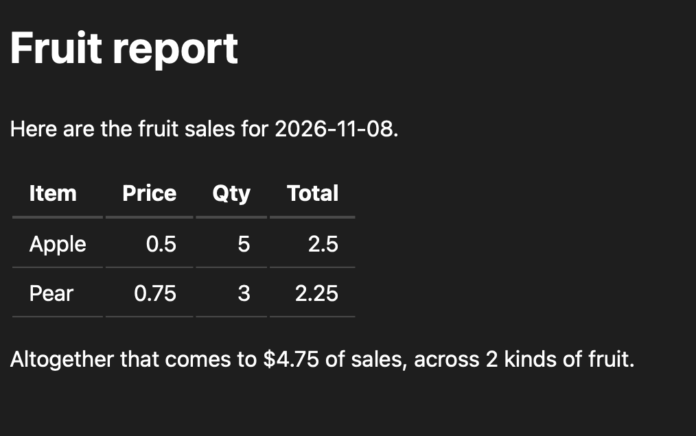

Last time we saw how Omasheet stores its data in a markdown-like text file (`.omx`).

Here's a new .omx file to check out:

---

# Fruit report

Here are the fruit sales for {{ today() }}.

'''omx

sheet Fruit

| Item   | Price | Qty | Total |
| ------ | ----- | --- | ----- |
| Apple  | 0.5   | 5   | *     |   
| Pear   | 0.75  | 3   | *     |   

Total := Price * Qty 

'''

Altogether that comes to ${{ Fruit.Total.sum() }} of sales, across {{ Fruit.Item.count() }} kinds of fruit.

---

This is "markdown plus" of course. Use `omasheet render file.md --html` to get a pretty version:

What's going on? Omasheet helps you to embed data into a wider markdown context. Great for authoring reports, presentations and integrating into an AI workflow.

1. Keyword `sheet` introduces and names the data
1. The `*` wildcards on calculated on the fly
1. Put functions such as `today()` and `.sum()` in `{{...}}`

Simples! Follow the Getting Started to try it yourself.

~librasteve

PS. Click on `feed` below if you would like to hear more ...
