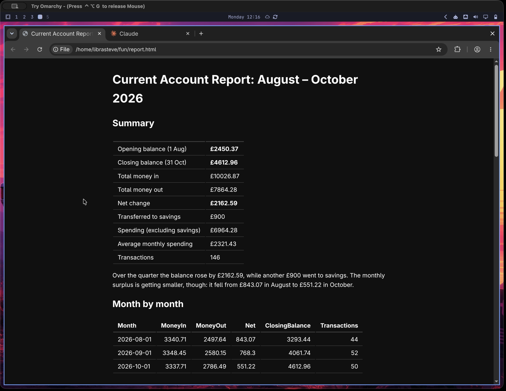

I have started a [YouTube channel](https://www.youtube.com/@librasteve) for Omasheet, and the first video is up. It is a screen recording of building a quarterly current account report from a plain bank statement CSV.

Last time we saw how to embed data in a markdown document. This time it is a real(ish) use case: 146 transactions from August to October, turned into a report with:

1. a summary (opening and closing balance, money in and out, net change)
1. month by month totals
1. spending by category and top merchants
1. the largest discretionary purchases
1. how payments were made

All of the numbers in the report text are computed with `{{...}}` expressions straight from the named columns in the `.omx` file, and the arithmetic is exact decimal. Change the data and `omasheet render report.md --html` gives you a fresh report.

That was done via a very, very simple AI request:- "make a report from that .csv using Omasheet". And you can imagine that a wide variety of prompt controls could be done from colours and layout, through to details on the analysis level and can be setup to be done on a recurring basis.

So, why Omasheet?

The key here is separation of concerns.

- keep the data in a data file (here, a `.csv`)
- [have your AI] put the queries and extracts in the markdown-like Omasheet format

That way you are not paying tokens to ship data points up and down. And you remove the risk of a common AI transposition or math error from the equation.

And the Omasheet AI skill means that this is delightfully easy.

Why not try it yourself?

~librasteve

PS. Click on `feed` below if you would like to hear more ...
