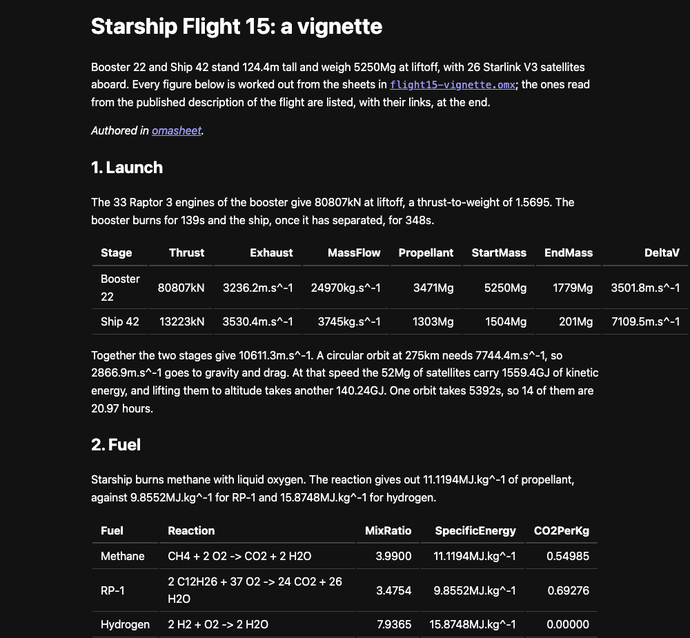
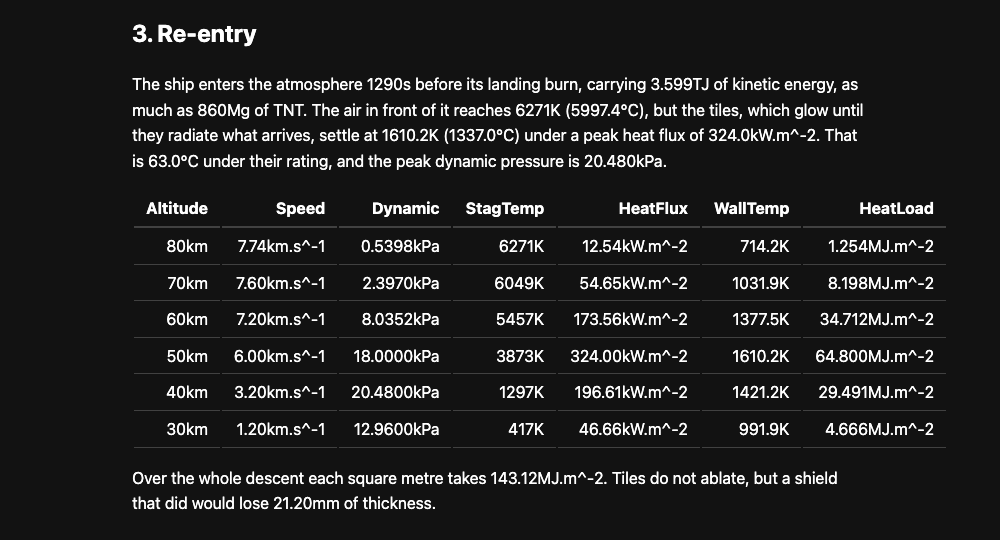

SpaceX Flight 15 is planned for today, Friday 13th November 2026, so here is a new showcase example: a vignette of the flight worked entirely in Omasheet.

It takes Booster 22 and Ship 42 through three stages of the flight: the launch, the methane and oxygen they burn, and the heat of the ship's return after about 14 orbits. Every number in the text is a `{{...}}` expression, and every table is a `select` over a sheet in the data file.

What is worth a look:

1. units are carried through every formula - thrust over weight comes out as a plain number, delta-v comes out in `m.s^-1`, heat load in `MJ.m^-2`
1. the figures read from the published description of the flight live on one `Flight15` sheet, each with a link to its source
1. anything not on that sheet is an assumption, and is marked as one right where it is written in the `.omx`
1. change a figure, run `omasheet render flight15-vignette.md --html`, and the whole report follows

The three files are in the `examples/showcase` folder of the Omasheet repo:

- [`flight15-vignette.omx`](https://github.com/librasteve/omasheet/blob/dev/examples/showcase/flight15-vignette.omx) - the data, constants and formulas
- [`flight15-vignette.md`](https://github.com/librasteve/omasheet/blob/dev/examples/showcase/flight15-vignette.md) - the report text with its embedded expressions
- [`flight15-vignette.html`](https://github.com/librasteve/omasheet/blob/dev/examples/showcase/flight15-vignette.html) - the rendered result

This is the same separation of concerns as the bank report: the data and the formulas are in one place, the prose is in another, and the arithmetic is done by the engine, not by an AI guessing at it.

The illustration is inspired by the flight, not endorsed by SpaceX - the sources for each figure are in the report, so check them before you rely on one.

Why not try it yourself?

~librasteve

PS. Click on `feed` below if you would like to hear more ...
