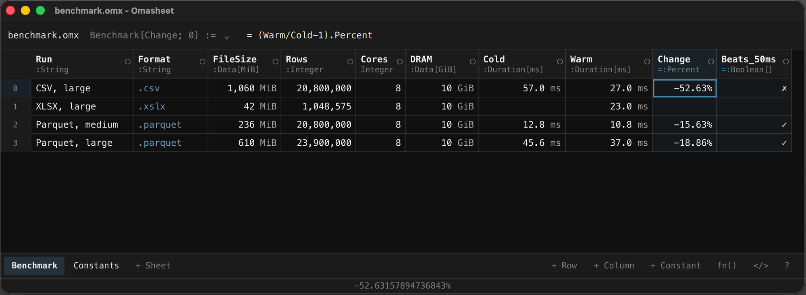
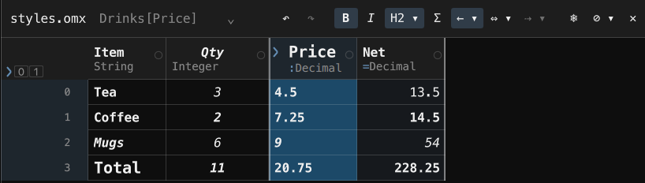


A brief tour of Omasheet. The complete reference for every type, function and option is in the [docs on GitHub](https://github.com/librasteve/omasheet/tree/main/docs).

<details class="sec" id="s1" open data-start markdown="1">
<summary><h2 id="introduction">Introduction</h2></summary>

<figure class="shot">

<figcaption>A sheet shown in the app: a column header for each column with its type beneath, four rows of data, and the formula for the Change column in the box at the top. Types, units and formats are covered later, in their own sections: <a href="#types">Types</a>, <a href="#units">Units</a> and <a href="#formats">Formats</a>.</figcaption>
</figure>

What to look at:

- `Top box` shows the source of the current cell, here the formula of `Change`, with the cell's address beside it: `Benchmark[Change; 0]`. Click or hit Enter to edit a cell.
- `Column head` shows the name. As cells are filled, so the column will infer the narrowest common type. Right click and Set type... to declare a type. This adds `:`, as in `:String` or `:Integer`. Square brackets hold the unit or format, as in `:Data[MiB]`. 
- `Formula column` has one formula for every row. Edit it once and every row follows. The `=` marks a formula column.
- `Head circle` opens the column control: sort ascending or descending, and a filter. See <a href="#sort-filter-query">Sort, Filter &amp; Query</a>.
- `Right-click` the head for `Set type…`, `Set unit…` and `Set format…`, described in <a href="#types">Types</a>, <a href="#units">Units</a> and <a href="#formats">Formats</a>.
- `Style bar` sits beside the formula box: undo and redo, bold, italic, heading level, alignment, width, freeze and hide. See <a href="#styles">Styles</a>.
- `Footer` has a tab for each sheet, and three buttons on the right: `fn()` lists the functions, `</>` shows the source of the whole file, and `?` lists the keyboard shortcuts.

</details>

<details class="sec" id="s2" markdown="1">
<summary><h2 id="plain-text">Plain Text</h2></summary>

An `.omx` file is plain text. Here's `benchmark.omx`:

```omx
const Target = 50        // ensure that rust "snap"

sheet Benchmark

| Run             | FileSize | Rows     | Cold | Warm | Change | Beats_50ms |
| --------------- | -------- | -------- | ---- | ---- | ------ | ---------- |
| CSV, large      | 1060     | 20800000 | 57   | 27   | *      | *          |
| XLSX, large     | 42       | 1048575  |      | 23   | *      | *          |
| Parquet, medium | 236      | 20800000 | 12.8 | 10.8 | *      | *          |
| Parquet, large  | 610      | 23900000 | 45.6 | 37   | *      | *          |

Change := (Warm/Cold-1).Percent
Beats_50ms := Cold <= Target
```
- A sheet is a Markdown table, so it reads as a table on GitHub too.
- `const Target = 50` names a value you can use anywhere in the file.
- `sheet Benchmark` starts a sheet, and the table under it is its data. A `*` cell has no value written in it: the column's formula gives it one.
- A cell that starts with `=` is a formula for that cell alone. A `:=` line is a formula for the whole column.
- An empty cell is missing: arithmetic with it gives missing, and an aggregate passes over it.
- Text after `//` in a line is a comment.
- Text in OMX, in a formula or a `const`, is in `'single quotes'`: `Label := if Margin > 20% then 'good' else 'thin'`.
- Text in a cell is Markdown, so `**bold**` and `[a link](there.md)` work in the app and in a rendered report. Put the text in `"double quotes"` to make it literal, shown exactly as written.

When you open it in the app, the file on disk stays the text you wrote. Every edit in the app rewrites that text. Every change can be reviewed, audited and tracked using `git`.

</details>

<details class="sec" id="s3" markdown="1">
<summary><h2 id="expressions">Expressions</h2></summary>

Omasheet expressions are written in OMX, a small language designed to fit neatly into a spreadsheet cell, to neatly represent features such as sort, filter and query operations and to be easy for humans and AIs to grok. An expression has no side effects: an expression reads cells and constants and gives a value. It is written in a `:=` column, after `=` in a cell, in `const` and `fn`, and between `{{ }}` in a report.

| Written | Means |
|---|---|
| `Sales` | the sheet |
| `Sales.Revenue` | the column, as a vector |
| `.Revenue` | the same column: a leading `.` means `this` sheet |
| `Sales[Revenue; 0..2]` | `[columns; rows]`, rows count from 0, `-1` is the last |
| `Sales[; Revenue > 100]` | the rows where the condition is true |
| `[Revenue; *-1]` | `*` is `this` row, so this is the row before |
| `[*-1; *-1]` | relative accessor, this is the col and row before |
| `[0; 0]` | absolute accessor, this is col=0, row=0 |

```omx
Profit := Revenue - Cost
Margin := (Profit / Revenue).Percent
Label  := if Margin > 20% then 'good' else 'thin'
Running := Revenue.cumsum()
Odd := 1, 3 ... Inf                    // a sequence, from its seeds
```

- Arithmetic between types gives the wider one, along `Integer` → `Decimal` → `Float` → `Scientific` → `Complex`. Exact numbers stay exact until a `Float` joins them.
- `x // y` is `x`, or `y` where `x` is empty. Comparisons chain: `0 < x <= 10`.
- **Conditionals.** A comparison, `==  !=  <  >  <=  >=` or `in`, gives `true` or `false`, and `and`, `or`, `xor` and `not` join them: `Beats_50ms := Cold <= Target`, `Ok := Margin > 10% and Cost < Budget`. A condition also picks rows, `Sales[; Revenue > 100]`.
- **`if … then … else`** is an expression of its own, so it can sit anywhere a value can, and it nests: `Label := if Margin > 20% then 'good' else if Margin > 5% then 'ok' else 'thin'`.
- `f(x, y)`, `x.f(y)` and `x |> f(y)` are the same call. A type name converts: `Integer(x)`, `x.Integer`.

The `pipe` operator `|>` is great for queries - see [Sort, Filter &amp; Query](#sort-filter-query) to learn more.

<details markdown="1">
<summary>Literals and operators</summary>

| Literal | Written |
|---|---|
| percent, fraction | `20%`, `<2 3/4>` |
| uncertain | `10 ± 0.1`, `10.5(3)` |
| quantity | `5kg`, `300cm`, `20°C` |
| scale | `1k.`, `1.5M.` |
| date, duration | `2025-01-31`, `PT1H30M` |
| list, range | `[1, 2, 3]`, `1..5`, `^n` |

From loosest to tightest: `|>`, `or`, `xor`, `and`, `not`, `//`, comparisons, ranges, `+ -`, `* / %`, negation, `**` (power), the uncertainty sign in `10 ± 0.1`, then `[ ]` and `.`. `**` runs right to left, so `2 ** 3 ** 2` is `2 ** 9`, and `±` binds tighter than `**`, so `10 ± 0.1 ** 2` is `(10 ± 0.1) ** 2`.

</details>

<details markdown="1">
<summary>Functions</summary>

The `fn()` button at the foot of the app lists every function. A function is called as `sum(x)`, `x.sum()` or `x |> sum()`, and you can add your own with `fn` in the file.

| Group | Functions |
|---|---|
| Vectors | `sum mean min max count len median product first last`. `count` counts what is not empty, `len` counts every cell |
| Spread | `std var quantile`: `std(x)` of a sample, `std(x, 0)` of a whole population, `quantile(x, 0.9)` |
| Down a column | `cum_sum cum_min cum_max cum_prod cum_count diff pct_change rank forward_fill backward_fill rolling_sum rolling_mean rolling_min rolling_max rolling_std shift` |
| Sheets | `filter select sort head tail group_by agg join` |
| Booleans | `xor nand nor`, and `all any none` of a column |
| Empty or not | `is_null is_not_null fill_null is_in` |
| Not a number | `is_nan is_not_nan is_finite is_infinite` |
| Text | `starts_with ends_with contains contains_any matches len_chars to_lowercase to_uppercase` |
| Showing a value | `fmt('.2f')` gives a value as text in a format |
| Chance | `rand roll pick`. `--seed 7` makes a run repeatable |
| Among a column | `is_unique is_duplicated is_first_distinct is_last_distinct` |
| Maths | `abs round floor ceil sqrt exp ln log10 log2 sin cos tan arcsinh arccosh arctanh` and more, and the constants `pi tau e c planck hbar kB NA R` |
| Complex | `re im conj arg sign` |
| Converting | `Integer Decimal Percent Float String Boolean Date Time Datetime Duration`, or `cast(x, Integer)` |
| Dates | `today now year month day weekday quarter week ordinal_day hour minute second date time is_leap_year` |
| Durations | `total_days total_hours total_minutes total_seconds` |
| Months | `add_months month_end month_start` |
| Time zones | `convert_time_zone utc local base_utc_offset time_zone` |

</details>

<details markdown="1">
<summary>Ranges &amp; Sequences</summary>

A **range** is a run of whole numbers written with `..`. A `^` on an end leaves that end out, and `^n` on its own is `0..^n`.

| Written | Gives |
|---|---|
| `1..5` | 1, 2, 3, 4, 5 |
| `1..^5` | 1, 2, 3, 4 |
| `1^..5` | 2, 3, 4, 5 |
| `1^..^5` | 2, 3, 4 |
| `^3` | 0, 1, 2 |

Use a range to select rows, `Sales[Revenue; 0..2]`, to test membership, `x in 1..5`, or to work on a run of numbers, `(1..5).sum()`.

A **sequence** fills a computed column from the terms you give, `terms ... limit`, and the rest follow a rule:

| Written | Gives |
|---|---|
| `1, 3 ... Inf` | 1, 3, 5, 7, … a constant difference |
| `1, 2, 4 ... Inf` | 1, 2, 4, 8, … a constant ratio |
| `5 ... Inf` | 5, 6, 7, … one term alone steps by one |
| `0, 1, $-1 + $-2 ... Inf` | 0, 1, 1, 2, 3, 5, … a rule of its own |
| `1, 3 ... 9` | 1, 3, 5, 7, 9, then empty |
| `'A', 'B' ... Inf` | A, B, … Z, AA, AB, … |
| `'Monday', 'Tuesday' ... Inf` | the days of the week, round and round |
| `'Jan', 'Feb' ... Inf` | the months of the year |
| `2025-01-01, 2025-01-08 ... Inf` | every seventh day |
| `2025-01-01, 2025-02-01 ... Inf` | the first of each month |

- `$-1` is the term before this one, `$-2` the one before that. A last term that reads `$-n` is the rule, and otherwise it is another starting term.
- With no rule the step is taken from the terms: their difference, or their ratio where three or more share one. Two terms are read as a difference, so a constant ratio needs three.
- `Inf` fills the column. Any other limit stops the sequence there and leaves the rows after it empty.
- A sequence fills a column: it cannot change how many rows the sheet has, and `... Inf` has no meaning anywhere else.

</details>

</details>

<details class="sec" id="s4" markdown="1">
<summary><h2 id="types">Types</h2></summary>

Omasheet keeps numbers exact for as long as it can, so a column of prices adds to the penny and `0.1 + 0.2` is exactly `0.3`:

```text
> 0.1 + 0.2 == 0.3
true
> 1/3 + 1/6
1/2
```

A column with no `Name : Type` line infers its type from its cells. Declare one with the `Set type...` column control, and every value in the column is read as that type. Columns with declared types reject incompatible data. Only `Integer` and `Fraction` keep every value exactly. A `Decimal` column holds its values to a fixed number of places (up to 38 decimals), so a `1/7` written into one is rounded to them, and a `Float` trades exactness for range. What is shown can be shorter still: a `Decimal`, a `Float` and a `Percent` are cut for display, `0.143·` or `41.67%`, with a `·` after a figure that has more digits. Point at the cell for the full value, or use `--exact` on the command line. If a value must not be rounded, declare the column `Fraction`.

| Type | Written |
|---|---|
| `Integer`, `Hex`, `Octal`, `Binary` | `42`, `0xff`, `0o17`, `0b101` |
| `Decimal` | `19.99`: exact, to the places the column keeps |
| `Fraction` | `1/7`, `2 3/4`: the exact rational, never rounded |
| `Percent` | `20%`: exact, shown as a percentage |
| `Float` | `1.5e3`, `Inf`, `NaN` |
| `Scientific` | `10.5(3)`, `10 ± 0.3`: a value with its uncertainty |
| `Quantity` | `5kg`, `9.81m.s^-2`, `20°C`: a number with a unit (see Units) |
| `Complex` | `3+4i` |
| `String`, `Boolean` | `hi`, `true` |
| `Date`, `Time`, `Datetime`, `Duration` | `2025-01-31`, `09:30`, `2025-01-31T09:30`, `PT1H30M` |
| `Url`, `Email`, `Uuid` | `https://example.com`, `name@example.com`, `7b4e2c10-…` |

**Text.** A `String` is written in `'single quotes'` in OMX, and in a cell it is Markdown unless it is in `"double quotes"`, which are a literal. In a cell, `**bold**` is bold and `"**bold**"` is the characters as written. Text made by a formula is shown as it is, and HTML in a cell is shown as text.

Arithmetic between types gives the wider one, along `Integer` → `Decimal` → `Float` → `Scientific` → `Complex`. Exact numbers stay exact until a `Float` joins them. A `Scientific` value such as `10.5(3)` carries its uncertainty through `+ - * / **` and the math functions.

<details markdown="1">
<summary>Set type…</summary>

```text
Numbers
   Integer
      Binary
      Octal
      Hex
   Fraction
   Decimal
      Percent
   Float
   Scientific
   Complex
Text
   String
      Email
      Url
      Uuid
Dates and times
   Datetime
      Date
      Time
      Duration
Other
   Boolean
   Quantity
   Currency
```

An indented type is a narrower kind of the one above it. Type a number of places, such as `Decimal(10)`, and the box offers `Decimal[10]`.

A quantity is just `Quantity` here. Its kind, such as `Mass` or `Duration`, comes from **Set unit…**.

</details>

</details>

<details class="sec" id="s5" markdown="1">
<summary><h2 id="units">Units</h2></summary>

A number followed at once by an SI unit, with no space, is a quantity: `5kg`, `300cm`, `9.81m.s^-2`, `20°C`. Quantities add, multiply and convert, and a calculation that mixes dimensions is an error that says why.

```text
> 5kg + 300g
5.3kg
> 2m * 3m
6m²
> 10m / 4s
2.5m⋅s⁻¹
> 5kg + 3m
error: cannot add kg and m: they measure Mass and Length
```

- A **sum** converts its right side to the unit of the left, so `300g + 5kg` is `5300g`.
- A **product or quotient** combines the units, and where they cancel the answer is a plain number: `6m / 3cm` is `200`.
- A unit of more than one term is joined with `.`, each term with an optional `^` exponent: `kg.m^2.s^-2`. All the SI prefixes work, from `q` to `Q`, and so do the metric non-SI units such as `l`, `t`, `h`, `bar` and `eV`.
- `.to` gives a value in another unit of the same dimension: `5kg.to('g')`.
- A column holds one kind of quantity, such as `Mass` or `Length`, declared as `Load : Mass[g]`. A value in another unit of that kind is converted to the column's unit.

<details markdown="1">
<summary>Set unit…</summary>

 Lists `kg`, `N`, `m^2`, or any unit you type, such as `mg` or `kN.m`. The column becomes a column of that kind of quantity, so `mg` makes it `Mass[mg]`. The column's head shows the unit once, `Mass[mg]`, and its cells are plain numbers. A `v` in the format, `Mass[mg; v]`, puts the unit in each cell too.

<details markdown="1">
<summary>Metric</summary>

```text
== SI Base
m | Length (metre)
kg | Mass (kilogram)
s | Duration (second)
A | Current (ampere)
K | Temperature (kelvin)
mol | AmountOfSubstance (mole)
cd | LuminousIntensity (candela)

== Data
b | Data (bit)
B | Data (byte)
b.s^-1 | DataRate
b.m^-2 | DataDensity

== Angle
rad | Angle (radian)
° | Angle (degree)
′ | Angle (arcminute)
″ | Angle (arcsecond)
gon | Angle (gon)
sr | SolidAngle (steradian)

== Timespan
min | Duration (minute)
h | Duration (hour)
d | Duration (day)
wk | Duration (week)
yr | Duration (year)

== Magnitude
g | Mass (gram)
t | Mass (tonne)
kt | Mass (kilotonne)
Mt | Mass (megatonne)
m^2 | Area
ha | Area (hectare)
m^3 | Volume
l | Volume (litre)

== Mechanical
Hz | Frequency (hertz)
m.s^-1 | Speed
m.s^-2 | Acceleration
m^3.s^-1 | Flow
N.s | Impulse
kg.m.s^-1 | Momentum
kg.m^2 | MomentOfInertia
rad.s^-1 | AngularSpeed
kg.m^2.s^-1 | AngularMomentum

== Physical
Pa | Pressure (pascal)
N | Force (newton)
J | Energy (joule)
W | Power (watt)
N.m | Torque
W.m^-2 | Irradiance
kg.m^-2 | ArealDensity
kg.m^-3 | Density

== Thermal
°C | Temperature (Celsius)
J.kg^-1 | SpecificEnergy
W.kg^-1 | SpecificPower
J.kg^-1.K^-1 | SpecificHeat
W.K^-1 | ThermalConductance
K.W^-1 | ThermalResistance

== Electromagnetic
C | Charge (coulomb)
V | Potential (volt)
Ω | Resistance (ohm)
S | Conductance (siemens)
F | Capacitance (farad)
H | Inductance (henry)
T | MagneticField (tesla)
Wb | MagneticFlux (weber)

== Astronomical
au | Length (astronomical unit)
ld | Length (light day)
ly | Length (light year)
pc | Length (parsec)
lm | LuminousFlux (lumen)
lx | Illuminance (lux)
Jy | SpectralFluxDensity (jansky)

== Chemical
Å | Length (angstrom)
Da | Mass (dalton)
cal | Energy (calorie)
kat | CatalyticActivity (katal)

== Radiation
Bq | Radioactivity (becquerel)
Ci | Frequency (curie)
rem | SpecificEnergy (rem)
Gy | Dose (gray)
Sv | SpecificEnergy (sievert)
R | RadiationExposure (roentgen)

== Contextual
nmi | Length (nautical mile)
are | Area (are)
barn | Area (barn)
ct | Mass (carat)
rev | Angle (revolution)
rpm | AngularSpeed (revs per min)
kn | Speed (knot)
sverdrup | Flow (sverdrup)
torr | Pressure (torr)
bar | Pressure (bar)
atm | Pressure (atmosphere)
eV | Energy (electronvolt)
Wh | Energy (watt-hour)
mhp | Power (metric horsepower)
tog | ThermalInsulance (tog)
gsm | ArealDensity (gram per square metre)
```

</details>

<details markdown="1">
<summary>Non-Metric</summary>

```text
== Length
in | Length (inch)
ft | Length (foot)
yd | Length (yard)
mi | Length (mile)
fur | Length (furlong)
ftm | Length (fathom)
chain | Length (chain)
rod | Length (rod)
thou | Length (thou)

== Mass
oz | Mass (ounce)
lb | Mass (pound)
st | Mass (stone)
cwt | Mass (hundredweight)
ton | Mass (short ton)
lton | Mass (long ton)
gr | Mass (grain)
ozt | Mass (troy ounce)
dwt | Mass (pennyweight)
slug | Mass (slug)

== Area
ft^2 | Area (square foot)
in^2 | Area (square inch)
mi^2 | Area (square mile)
ac | Area (acre)

== Volume
ft^3 | Volume (cubic foot)
in^3 | Volume (cubic inch)
gal | Volume (US gallon)
qt | Volume (US quart)
pt | Volume (US pint)
cup | Volume (US cup)
floz | Volume (US fluid ounce)
tbsp | Volume (tablespoon)
tsp | Volume (teaspoon)
bbl | Volume (barrel)
impgal | Volume (imperial gallon)
imppint | Volume (imperial pint)
cord | Volume (cord)

== Mechanical
mph | Speed (mile per hour)
fps | Speed (foot per second)
ft.s^-2 | Acceleration (foot per second squared)

== Physical
lbf | Force (pound-force)
ozf | Force (ounce-force)
psi | Pressure (pound per square inch)
btu | Energy (British thermal unit)
therm | Energy (therm)
lbf.ft | Torque (pound-foot)
hp | Power (mechanical horsepower)

== Thermal
°F | Temperature (Fahrenheit)
°R | Temperature (Rankine)

== Typographic
pica | Length (pica)
point | Length (point)
```

</details>

<details markdown="1">
<summary>Currency</summary>

Every currency is a unit by its code, with the US dollar `USD` as the base, and the signs `$ € £ ¥` and a few more are read as codes too. The list has about 338 currencies, fiat and crypto, each as its code, its name and its sign where it has one.

**Daily rates.** Rates change about once a day. Omasheet takes them from [currency-api](https://latest.currency-api.pages.dev/v1/currencies/usd.json), which publishes one file of how many of each currency make a US dollar, with its date. To fetch it **needs a web connection**:
- While a file with money in it is open, the app fetches the latest rates as it starts, and again every four hours it is left open. A file with no money in it never fetches.
- Without a connection, or if a fetch fails, the rates stay as they were: the copy kept from the last fetch, or else the snapshot built into the program.
- The status bar says what date the rates are as of: `rates 2026-11-18 (today)`, or `(cached)` or `(bundled)` for the rates of an earlier day.
- Calculating a file never fetches rates by itself, so the same file and the same rates always give the same answer. A converted amount depends on the rates in use, so a report that shows one should say what date they were as of.
- On the command line, `omasheet rates` says what date the rates are as of and where they came from, and `omasheet rates update` fetches the latest.

```text
USD | US dollar $
EUR | Euro €
GBP | British Pound £
JPY | Japanese Yen ¥ ￥
CHF | Swiss Franc
CAD | Canadian Dollar C$
AUD | Australian Dollar A$
CNY | Chinese Yuan Renminbi
INR | Indian Rupee ₹
BTC | Bitcoin
ETH | Ethereum
AAVE | Aave
ADA | Cardano
AED | Emirati Dirham
AFN | Afghan Afghani
AKT | Akash Network
ALGO | Algorand
ALL | Albanian Lek
AMD | Armenian Dram
AMP | Amp
ANG | Dutch Guilder
AOA | Angolan Kwanza
APE | ApeCoin
APT | Aptos
AR | Arweave
ARB | Arbitrum
ARS | Argentine Peso
ATOM | Cosmos
ATS | Austrian Schilling
AVAX | Avalanche
AWG | Aruban or Dutch Guilder
AXS | Axie Infinity
AZM | Azerbaijani Manat
AZN | Azerbaijan Manat
BAKE | BakeryToken
BAM | Bosnian Convertible Mark
BAT | Basic Attention Token
BBD | Barbadian or Bajan Dollar
BCH | Bitcoin Cash
BDT | Bangladeshi Taka
BEF | Belgian Franc
BGN | Bulgarian Lev
BHD | Bahraini Dinar
BIF | Burundian Franc
BMD | Bermudian Dollar
BNB | Binance Coin
BND | Bruneian Dollar
BOB | Bolivian Bolíviano
BRL | Brazilian Real
BSD | Bahamian Dollar
BSV | Bitcoin SV
BSW | Biswap
BTCB | Bitcoin BEP2
BTG | Bitcoin Gold
BTN | Bhutanese Ngultrum
BTT | BitTorrent
BUSD | Binance USD
BWP | Botswana Pula
BYN | Belarusian Ruble
BYR | Belarusian Ruble
BZD | Belizean Dollar
CAKE | PancakeSwap
CDF | Congolese Franc
CELO | Celo
CFX | Conflux
CHZ | Chiliz
CLP | Chilean Peso
CNH | Chinese Yuan Renminbi Offshore
COMP | Compound
COP | Colombian Peso
CRC | Costa Rican Colon
CRO | Crypto.com Chain
CRV | Curve DAO Token
CSPR | Casper
CUC | Cuban Convertible Peso
CUP | Cuban Peso
CVE | Cape Verdean Escudo
CVX | Convex Finance
CYP | Cypriot Pound
CZK | Czech Koruna
DAI | DAI
DASH | Digital Cash
DCR | Decred
DEM | German Deutsche Mark
DFI | DfiStarter
DJF | Djiboutian Franc
DKK | Danish Krone
DOGE | Dogecoin
DOP | Dominican Peso
DOT | Polkadot
DYDX | dYdX
DZD | Algerian Dinar
EEK | Estonian Kroon
EGLD | Elrond
EGP | Egyptian Pound
ENJ | Enjin Coin
EOS | EOS
ERN | Eritrean Nakfa
ESP | Spanish Peseta
ETB | Ethiopian Birr
ETC | Ethereum Classic
EURC | EURC
FEI | Fei USD
FIL | Filecoin
FIM | Finnish Markka
FJD | Fijian Dollar
FKP | Falkland Island Pound
FLOW | Flow
FLR | FLARE
FRAX | Frax
FRF | French Franc
FTT | FarmaTrust
GALA | Gala
GEL | Georgian Lari
GGP | Guernsey Pound
GHC | Ghanaian Cedi
GHS | Ghanaian Cedi
GIP | Gibraltar Pound
GMD | Gambian Dalasi
GMX | Goldmaxcoin
GNF | Guinean Franc
GNO | Gnosis
GRD | Greek Drachma
GRT | The Graph
GTQ | Guatemalan Quetzal
GUSD | Gemini US Dollar
GYD | Guyanese Dollar
HBAR | Hedera
HKD | Hong Kong Dollar HK$
HNL | Honduran Lempira
HNT | Helium
HOT | Hydro Protocol
HRK | Croatian Kuna
HT | Huobi Token
HTG | Haitian Gourde
HUF | Hungarian Forint
ICP | Internet Computer
IDR | Indonesian Rupiah
IEP | Irish Pound
ILS | Israeli Shekel ₪
IMP | Isle of Man Pound
IMX | Immutable X
INJ | Injective
IQD | Iraqi Dinar
IRR | Iranian Rial
ISK | Icelandic Krona
ITL | Italian Lira
JEP | Jersey Pound
JMD | Jamaican Dollar
JOD | Jordanian Dinar
KAS | KAS
KAVA | Kava
KCS | Kucoin
KDA | Kadena
KES | Kenyan Shilling
KGS | Kyrgyzstani Som
KHR | Cambodian Riel
KLAY | Klaytn
KMF | Comorian Franc
KNC | Kyber Network Crystals
KPW | North Korean Won
KRW | South Korean Won ₩
KSM | Kusama
KWD | Kuwaiti Dinar
KYD | Caymanian Dollar
KZT | Kazakhstani Tenge
LAK | Lao Kip
LBP | Lebanese Pound
LDO | Lido DAO Token
LEO | LEOcoin
LINK | Chainlink
LKR | Sri Lankan Rupee
LRC | Loopring
LRD | Liberian Dollar
LSL | Basotho Loti
LTC | Litecoin
LTL | Lithuanian Litas
LUF | Luxembourg Franc
LUNA | Terra
LUNC | LUNC
LVL | Latvian Lat
LYD | Libyan Dinar
MAD | Moroccan Dirham
MANA | Mana Coin Decentraland
MBX | MobieCoin
MDL | Moldovan Leu
MGA | Malagasy Ariary
MGF | Malagasy Franc
MINA | Mina
MKD | Macedonian Denar
MKR | Maker
MMK | Burmese Kyat
MNT | Mongolian Tughrik
MOP | Macau Pataca
MRO | Mauritanian Ouguiya
MRU | Mauritanian Ouguiya
MTL | Maltese Lira
MUR | Mauritian Rupee
MVR | Maldivian Rufiyaa
MWK | Malawian Kwacha
MXN | Mexican Peso
MXV | MXV
MYR | Malaysian Ringgit
MZM | Mozambican Metical
MZN | Mozambican Metical
NAD | Namibian Dollar
NEAR | NEAR Protocol
NEO | NEO
NEXO | NEXO
NFT | NFT
NGN | Nigerian Naira ₦
NIO | Nicaraguan Cordoba
NLG | Dutch Guilder
NOK | Norwegian Krone
NPR | Nepalese Rupee
NZD | New Zealand Dollar NZ$
OKB | Okex
OMR | Omani Rial
ONE | Menlo One
OP | Optimism
ORDI | ORDI
PAB | Panamanian Balboa
PAXG | PAX Gold
PEN | Peruvian Sol
PEPE | PEPE
PGK | Papua New Guinean Kina
PHP | Philippine Peso ₱
PI | Plian
PKR | Pakistani Rupee
PLN | Polish Zloty
POL | Proof Of Liquidity
PTE | Portuguese Escudo
PYG | Paraguayan Guarani
QAR | Qatari Riyal
QNT | Quant
QTUM | QTUM
ROL | Romanian Leu
RON | Romanian Leu
RPL | Rocket Pool
RSD | Serbian Dinar
RUB | Russian Ruble ₽
RUNE | THORChain (ERC20)
RVN | Ravencoin
RWF | Rwandan Franc
SAND | The Sandbox
SAR | Saudi Arabian Riyal
SBD | Solomon Islander Dollar
SCR | Seychellois Rupee
SDD | Sudanese Dinar
SDG | Sudanese Pound
SEK | Swedish Krona
SGD | Singapore Dollar S$
SHIB | Shiba Inu
SHP | Saint Helenian Pound
SIT | Slovenian Tolar
SKK | Slovak Koruna
SLE | Sierra Leonean Leone
SLL | Sierra Leonean Leone
SNX | Synthetix Network
SOL | Solana
SOS | Somali Shilling
SPL | Seborgan Luigino
SRD | Surinamese Dollar
SRG | Surinamese Guilder
SSP | South Sudanese Pound
STD | Sao Tomean Dobra
STN | Sao Tomean Dobra
STX | Stacks
SUI | Sui
SVC | Salvadoran Colon
SYP | Syrian Pound
SZL | Swazi Lilangeni
THB | Thai Baht ฿
THETA | Theta
TJS | Tajikistani Somoni
TMM | Turkmenistani Manat
TMT | Turkmenistani Manat
TND | Tunisian Dinar
TOP | Tongan Pa'anga
TRL | TRL
TRX | TRON
TRY | Turkish Lira ₺
TTD | Trinidadian Dollar
TUSD | True USD
TVD | Tuvaluan Dollar
TWD | Taiwan New Dollar
TWT | Trust Wallet Token
TZS | Tanzanian Shilling
UAH | Ukrainian Hryvnia ₴
UGX | Ugandan Shilling
UNI | Uniswap
USDC | USDC
USDD | USDD
USDP | USDP Stablecoin
USDT | Tether
UYU | Uruguayan Peso
UZS | Uzbekistani Som
VAL | Vatican City Lira
VEB | Venezuelan Bolívar
VED | VED
VEF | Venezuelan Bolívar
VES | Venezuelan Bolívar
VET | Vechain
VND | Vietnamese Dong ₫
VUV | Ni-Vanuatu Vatu
WAVES | Waves
WEMIX | WEMIX
WOO | WOO Network
WST | Samoan Tala
XAF | Central African CFA Franc BEAC
XAG | Silver Ounce
XAU | Gold Ounce
XAUT | Tether Gold
XBT | XBT
XCD | East Caribbean Dollar
XCG | Xchange
XCH | Chia
XDC | XDC Network
XDR | IMF Special Drawing Rights
XEC | Eternal Coin
XEM | NEM
XLM | Stellar Lumen
XMR | Monero
XOF | CFA Franc
XPD | Palladium Ounce
XPF | CFP Franc
XPT | Platinum Ounce
XRP | Ripple
XTZ | Tezos
YER | Yemeni Rial
ZAR | South African Rand
ZEC | ZCash
ZIL | Zilliqa
ZMK | Zambian Kwacha
ZMW | Zambian Kwacha
ZWD | Zimbabwean Dollar
ZWG | ZWG
ZWL | Zimbabwean Dollar
```

</details>

<details markdown="1">
<summary>Prefixes</summary>

The **Prefixes** button opens this table. Put a prefix before a unit: `1km` is `1000m`. Use the binary ones for data: `1Kib` is `1024b`. Use one with a dot for plain numbers: `1M.` is `1,000,000`.

```text
Symbol  Name    Power   Size
Q       quetta  10^30   1e30
R       ronna   10^27   1e27
Y       yotta   10^24   1e24
Z       zetta   10^21   1e21
E       exa     10^18   1e18
P       peta    10^15   1e15
T       tera    10^12   1e12
G       giga    10^9    1e9
M       mega    10^6    1000000
k       kilo    10^3    1000
h       hecto   10^2    100
da      deca    10^1    10
d       deci    10^-1   0.1
c       centi   10^-2   0.01
m       milli   10^-3   0.001
μ       micro   10^-6   0.000001
n       nano    10^-9   1e-9
p       pico    10^-12  1e-12
f       femto   10^-15  1e-15
a       atto    10^-18  1e-18
z       zepto   10^-21  1e-21
y       yocto   10^-24  1e-24
r       ronto   10^-27  1e-27
q       quecto  10^-30  1e-30
Ki      kibi    2^10    1024
Mi      mebi    2^20    1048576
Gi      gibi    2^30    1.074e9
Ti      tebi    2^40    1.100e12
Pi      pebi    2^50    1.126e15
Ei      exbi    2^60    1.153e18
Zi      zebi    2^70    1.181e21
Yi      yobi    2^80    1.209e24
Ri      robi    2^90    1.238e27
Qi      quebi   2^100   1.268e30
```

</details>

</details>

</details>

<details class="sec" id="s6" markdown="1">
<summary><h2 id="formats">Formats</h2></summary>

 For data cells, the literal originally entered defines the type. Values are stored exactly and formats never affect this. The underlying value is shown in the bottom bar when you hover over any cell that hides precision for ease of display.
 
 By default, the app displays numbers in an adaptive way, **whatever their type**. A smallish number shows as a few digits, such as `10` or `0.01`. A very large or very small number shows in exponential format, such as `1e+30` or `1e-16`, rather than as a long run of zeros. A `Decimal` is shown rounded to three places, with a trailing `·` where it stores more digits.  A `Percent` is shown rounded to two places, with no `·`. Set a column format to override these defaults.

A format says how a column's cells are shown, without changing them. It goes in the column's declaration, after the type and its unit, behind a `;`. The Benchmark sheet above is declared like this:

```omx
FileSize   : Data[MiB; v_'.0f]       // 1,060 MiB
Cold       : Duration[ms; v_.1f]     // 57.0 ms
Change     : Percent
Beats_50ms : Boolean[✓✗]             // ✓ or ✗
```

A `Decimal` shows differently depending on how it is declared. A bare `Decimal` holds ten places and shows at most three, with a `·` after a figure that has more digits. `Decimal[2]` holds two places and shows exactly two, so `1.5` reads `1.50`. A format overrides both:

```omx
A : Decimal                  // 12345.6789 shows as 12345.679·
B : Decimal[2]               // 1.5 shows as 1.50
C : Decimal[4; .1f]          // 0.1234 shows as 0.1
```

The padding is display only: the value held is still `1.5`, and `--exact` on the command line shows every place held. A formula column with no declared type does not take its inputs' places, so declare it, `G : Decimal[2]`, to get two.

Money takes a currency and a format, and conversions use rates you can date-stamp:

```omx
Revenue : Currency[USD; $.2f]
Tax := Revenue * TaxRate
```

<details markdown="1">
<summary>Set format…</summary>

For a column of numbers, dates, times or quantities. It shows the cells in a format without changing them. The box holds the format in use and checks it as you type, saying in red what is wrong. Under it are the formats the column's type takes, each with what it shows: click one to put it in the field, or use Up and Down. **Formats** opens the legend below, for the column's type.

| Type | A format | Shows |
|---|---|---|
| `Decimal` | `'.2f` | `1,234.50` |
| `Float` | `.3g` | `3.14` |
| `Scientific` | `±.3e-3` | `10.5 ± 0.3` |
| `Date` | `%d %b %Y` | `31 Jan 2025` |
| `Boolean` | `✓✗` | `✓` |

A format is flags, a width, `.places` and a conversion, in that order, and only the conversion is needed: `08.2f` is zero fill, width 8, two places, fixed, `00012.50`.

| Part | Writes | Example |
|---|---|---|
| `'` | group the digits in threes | `'.0f` → `1,234` |
| `+` | always show the sign | `+.1f` → `+2.5` |
| `0` | fill the width with zeros | `08.2f` → `00012.50` |
| `-` | align left in the width | `-8.1f` → `2.5` |
| `.2` | two places after the point | `.2f` → `3.14` |
| `d` `f` `e` `g` | whole, fixed, exponent, or whichever reads better | `.3g` → `3.14` |
| `x` `o` `b` | hexadecimal, octal, binary (`#` adds the prefix) | `#x` → `0xff` |
| `±` `~` | uncertainty as `10.50 ± 0.30`, or the value alone | `±.2f` → `10.50 ± 0.30` |
| `v` `_` | the unit in each row, with a space before it | `g; v_.1f` → `10.5 g` |
| `*` | a metric prefix that suits each value | `*m` → `1.5km`, `2mm` |
| `s` `min` `h` `d` `wk` `iso` | a duration in that unit, or as ISO 8601 | `h; .2f` → `1.50`, `iso` → `PT1H30M` |
| `%Y %m %b %d %a` | year, month, month name, day, weekday | `%b` → `Jan` |
| `%H %M %S %p %Z` | hour, minute, second, AM or PM, zone | `%H` → `17` |
| `%x %X %c` | a date, a time, or both, as your locale writes them | `%x` → `31/01/2025` |
| `$` | a currency sign before the number | `EUR; $` → `€4.55` |

A Boolean format is any two different characters, the symbol for true and then for false: `10`, `xo`, `XO`, `✓✗`.

</details>

</details>

<details class="sec" id="s7" markdown="1">
<summary><h2 id="styles">Styles</h2></summary>

Styles are Markdown in the sheet itself, so they travel with the file and show in a diff. There is no style language to learn.

<figure class="shot">

<figcaption>The Drinks sheet, with the Price column selected. The style bar shows what the selection has: bold, heading level 2 and left alignment are lit. The source is below.</figcaption>
</figure>

Only the column head and/or the leftmost row cell carry style markdown, this is then extended over the whole grid. Styles can only be applied to whole columns or rows.

```omx
sheet Drinks

Item  : String[wrap]

| **Item**     | _Qty_        | ## **Price** | ^ Net |
| :----------- | :----------: | :----------- | ----- |
| Tea          | 3            | 4.50         | *     |
| **Coffee**   | 2            | 7.25         | *     |
| _Mugs_       | 6            | 9            | *     |
| ## **Total** | 11           | 20.75        | *     |

Net := Qty * Price
```

- `Alignment` is the colons of the rule line: `:---` left, `:---:` centre, `---:` right.
- `Bold` and `italic` are `**x**` and `_x_`.
- `Heading` is `## `, one to six `#`s.
- `Width` is the length of a column's `---`, plus `:`s.
- `Clip` and `wrap` set what a long text does at its column's edge: `String[clip]` or `String[wrap]`.

**Blocks.** A heading opens a block to the next heading of its level or higher. `^` in front marks a row or column that sums its block up: it stands at the block's foot and stays in view when the block is closed. A `^ ###` sums up the `###` block it ends, and a plain `^` the block nearest to it. Inside a summary, `block` is the rows under the head, so every summary row is the same formula, e.g. `= [A; block].sum()`.

A `rollup(keys) |> agg(...)` is a sheet of blocks made for you: a head row for each group, the groups inside it, and a summary row of the aggregates at the foot. In the app its keys are shown as one column, each row naming only its own level, and a summary is marked with a `Σ`.

**In the app.** The style bar reads, left to right: `↶` `↷` for undo and redo, then `B`, `I`, `H` (heading level), `Σ` (summary), `☰` alignment, `⇔` width and `→` wrap, which are written to the file, and then `❄` and `⊘`, which are not. `✕` clears all styles from the selection.

- `B`, `I`, `H` and `Σ` need whole rows or columns selected; on a block of cells the footer says so. `✕` clears the selection's styles, and its column width, after asking.
- `❄` freezes the rows above and the columns to the left of the selected cell, so that they stay in view as the rest scrolls.
- `⊘` hides the selected columns or rows, with a double line where something is hidden. `Hide empty` hides every row with nothing but its leftmost cell and every column with nothing in it, such as a block's empty head columns and rows. `Show last`, `Show all` and `Hide again` step back and forth.
- `Carets` on a block's head fold it away. The corner buttons `0 1 2` open every block down to that depth. A block is drawn as a box, the outermost in a full line and the block inside it fainter, and never more than two levels.

Folding, hiding and freezing belong to the reader's view. They are not kept in the file, and hidden cells still calculate.

</details>

<details class="sec" id="s8" markdown="1">
<summary><h2 id="sort-filter-query">Sort, Filter &amp; Query</h2></summary>

Chain stages with `|>`. Each stage takes a sheet and hands a new sheet to the next. Stages run on [Polars](https://pola.rs), so a table of millions of rows is as easy as a dozen.

```omx
Passengers
  |> filter(Survived == 1)
  |> sort(Age)
  |> select(Name, Age)
  |> head(5)

sheet ByClass := Passengers
  |> group_by(Pclass)
  |> agg(Aboard := Name.len(),
         MeanFare := Fare.mean())
```

| Stage | Makes |
|---|---|
| `filter(cond)` | the rows the condition is true of |
| `select(cols)`, `sort(cols)`, `head(n)`, `tail(n)` | columns, order, first or last rows |
| `group_by(keys) |> agg(…)` | a row per key, with aggregates |
| `join(Other, keys)` | rows whose keys match; add `left` to keep the rest |

A **view** reads its rows from a Parquet or CSV file instead of the `.omx`, so the data stays where it is and the file holds only the schema and the formulas:

```omx
view Sales := dataframe['data/sales.parquet']

Month   : String
Revenue : Integer
Profit := Revenue - Cost
```

The file is scanned lazily, never read into memory whole, and a formula column is calculated in one step over the whole column.

**Filtering in the app.** The circle at the right of a column's header opens its popup: **Sort Ascending**, **Sort Descending**, and the column's filter. A filter is an expression in which `*` is the cell, such as `* >= 3`, and the rows it is not true of are hidden. The box turns red while the expression is wrong, and holding the pointer over it says why, so the popup opens at once on a view of millions of rows. **Apply** applies it and leaves the popup open to try another, **Clear filter** removes it, and **Close** or Esc closes it. The circle is solid while the column is filtered, and filters on several columns all apply. Ctrl+Shift+F opens the popup of the column the cursor is in. A filter is a view and nothing more: the file, a save and an export still hold every row.

<details markdown="1">
<summary>Operators: what a filter can say</summary>

The **Operators** button opens this legend, trimmed to the column's type. It compares values, not what is shown, so `* == 3` finds a cell shown as `3.00`. An empty cell fails every comparison, so `* != 3` hides it too, and `* != 3 or * == ''` keeps it.

| Write | Keeps the rows where the cell | Example |
|---|---|---|
| `==` `!=` `<` `<=` `>` `>=` | is equal, not equal, less, or greater | `* >= 3` |
| `a < * <= b` | is in a range: comparisons chain | `0 < * <= 10` |
| `in [ ]`, `.is_in([ ])` | is one of a list | `* in [1, 10]` |
| `in a..b` | is in a range of values (numbers) | `* in 1..5` |
| `.starts_with(s)` | starts with `s`, or with a letter `'A'..'C'` | `*.starts_with('A'..'C')` |
| `.ends_with(s)` `.contains(s)` | ends with, or has, `s` in it | `*.contains('an')` |
| `.matches(re)` | matches a regular expression | `*.matches('^A.*n$')` |
| `.to_lowercase()` `.to_uppercase()` | changes case first, to ignore it | `*.to_lowercase().contains('an')` |
| `.len_chars()` | the number of characters | `*.len_chars() > 3` |
| `.is_null()` | is empty | `*.is_null()` |
| `== ''` `!= ''` | is, or is not, empty text | `* != ''` |
| `.is_duplicated()` | is in the column more than once | `*.is_duplicated()` |
| `.is_first_distinct()` | is the first of its value | `*.is_first_distinct()` |
| `.is_nan()` `.is_finite()` | holds NaN, or a finite number | `*.is_finite()` |
| `.year .month .day` | the parts of a date | `*.year == 2025` |
| `.weekday` | 1 Monday to 7 Sunday | `*.weekday >= 6` |
| `.hour .minute .second` | the parts of a time | `*.minute == 0` |
| `.total_hours()` | a duration in hours, also days, minutes, seconds | `*.total_hours() > 1.5` |
| `and` `or` `not` `( )` | join conditions | `(* < 1 or * > 10) and * != 5` |

A duration is compared with a quantity of time, `* > 1h` or `* < 90min`.

</details>

</details>

<details class="sec" id="s9" markdown="1">
<summary><h2 id="reports">Reports</h2></summary>

A report is a Markdown document with a sheet inside it. The numbers in the prose are worked out from the data, so the explanation and the calculation live in one file that can be reviewed and diffed.

````markdown
---
title: Opening a big file
files: [benchmark.omx]
---

The CSV of {{ Benchmark.FileSize[0] }} takes {{ Benchmark.Cold[0] }} cold,
over the {{ Target }} target.

{{ Benchmark |> select(Run, Warm, Cold, Change) }}
````

```sh
omasheet render report.md                       # Markdown, with the values in place
omasheet render report.md --html -o report.html
```

- `files:` names the `.omx` files. A fenced `omx` block is a file too, so a sheet can sit inside the document.
- `{{ expression }}` is replaced by its value, and a sheet becomes a Markdown table.
- A tool that does not know Omasheet shows the braces as they are, so a report stays readable on GitHub.
- `--now` and `--seed` fix `today()` and `rand()`, so a rebuilt report can be compared with the last one. Run `render` as part of a build to keep a report fresh.

</details>

<details class="sec" id="s10" markdown="1">
<summary><h2 id="command-line">Command Line</h2></summary>

Everything the app does is available on the command line. `omasheet` with no command, or with only a file, opens the app. Every other command prints or writes and returns.

| Command | Does |
|---|---|
| `omasheet` | open the app on a new file |
| `omasheet file.omx` | open the app on a `.omx`, `.csv`, `.json`, `.xlsx` or `.parquet` file |
| `omasheet print file.omx` | calculate a file and print its sheets |
| `omasheet eval 'expr'` | work out one expression |
| `omasheet eval file.omx 'expr'` | work out an expression against a file's sheets and constants |
| `omasheet lint file.omx` | check a file without calculating it |
| `omasheet import file.xlsx` | write an XLSX Workbook, CSV, JSON or Parquet file as an `.omx` |
| `omasheet export file.omx --xlsx` | write the calculated sheets as XLSX, `--csv`, `--json` or `--parquet` |
| `omasheet render report.md` | render a Markdown report with its files calculated |

```sh
omasheet lint benchmark.omx                                # every mistake at once, with its line
omasheet print benchmark.omx                               # the sheet, with the * cells filled in
omasheet eval benchmark.omx 'Benchmark[Run; Cold > 50]'    # ['CSV, large']
omasheet eval '1/3 + 1/6'                                  # 1/2, exactly
```

<details markdown="1">
<summary>Options</summary>

These work on `print`, `eval`, `import`, `export` and `render`:

| Option | Does |
|---|---|
| `--exact` | show every number in full |
| `--now 2025-01-31T09:30` | fix what `today()` and `now()` give |
| `--seed 7` | fix what `rand`, `roll` and `pick` give, so a run can be repeated |
| `--zone Europe/London` | stand in for this machine's time zone |
| `--locale` | show dates and times as this machine's locale writes them |

`lint` reports every mistake at once, with its line and, usually, a `help:` line saying what to write instead. `eval` reads the expression from standard input when none is given.

</details>

<details markdown="1">
<summary>Working with AI agents</summary>

An `.omx` file is readable text with typed columns and one formula per column, so an agent can write, lint and check it. Omasheet ships an agent skill that teaches the loop: write the text, `lint` it, `print` it and read the result, and spot-check a number with `eval`. An agent should not report a file as working until `print` has run clean.

</details>

</details>

<details class="sec" id="s11" markdown="1">
<summary><h2 id="import-export">Import / Export</h2></summary>

Omasheet reads and writes XLSX Workbooks, CSV, JSON and Parquet files, so it fits in with the tools around it. Opening one of them in the app imports it, and **Ctrl+E** exports the file you have open as XLSX, CSV or JSON.

```sh
omasheet import data.xlsx                      # prints the .omx it makes
omasheet import data.xlsx -o data.omx          # or writes it
omasheet export budget.omx --xlsx              # budget.xlsx, beside the file
omasheet export budget.omx --parquet --meta    # keep the formulas in the Parquet
```

- **Import** prints the file it makes, and reports anything that was changed or left behind. `-o FILE` writes it instead.
- **Export** writes beside the file: `budget.omx` becomes `budget.xlsx`, `budget.csv`, `budget.json` or `budget.parquet`. `-o FILE` writes it elsewhere, and `--sheet NAME` exports one sheet.
- **CSV and Parquet hold one sheet**, so a file with several is written as `budget.Sales.csv`, and so on.
- **Parquet and formulas.** `--meta` keeps the file's formulas, constants and functions in the Parquet's metadata, so importing it gives them back. `--decimal` writes a `Fraction` column as the nearest `Float64`.
- **Big files.** A Parquet or CSV file can be a read-only `view`, so the data stays where it is. See Sort, Filter &amp; Query.
- **Markdown reports.** `omasheet render` turns a Markdown document with `{{ }}` values into Markdown or a full HTML page. See Reports.

</details>

<details class="sec" id="s12" markdown="1">
<summary><h2 id="shortcuts">Keyboard Shortcuts</h2></summary>

Press Ctrl+/ (Cmd+/ on a Mac) in the app, or the `?` button at the foot, to show this list, which is copied here as the app shows it.

```text
Ctrl+/               Help
Ctrl+.               Action menu
Ctrl+Z / Ctrl+Y      Undo / redo

Ctrl++ / Ctrl+-      Zoom in / out
Ctrl+0               Reset zoom

Ctrl+C / X / V       Copy / cut / paste
Ctrl+Shift+V         Paste values
Ctrl+Shift+R         Paste references
Ctrl+Shift+T         Paste transposed
Delete               Clear
Ctrl+Delete          Delete

Ctrl+O / S           Open (in a new window) / save
Ctrl+Shift+S         Save as
Ctrl+E               Export

Ctrl+K               New constant
Ctrl+Shift+F         Filter this column
Ctrl+D               Duplicate sheet
Ctrl+Alt+N           New sheet
Ctrl+Shift+N         New window
Ctrl+N               New file, in a new window
Ctrl+W               Close this window

Ctrl+Enter           Insert row/col after
Ctrl+Shift+Enter     Insert row/col before
Ctrl+Arrows          Go to end cell
Ctrl+Alt+L/R         Previous / next sheet
Ctrl+Alt+Shift+L/R   Move sheet left / right
Alt+Enter            Newline
Ctrl+click           Open link

F1                   View functions
F2                   Edit
F3                   View source
F4                   Cycle column settings
F11                  Fullscreen

A cell starting with = is a formula
In a formula, text is in 'single quotes'
Text is Markdown unless in "double quotes"
A column's filter: * is the cell, as 0 < * <= 10
```

A `view` sheet is read-only, and the app says so if you try to type in it.

</details>

